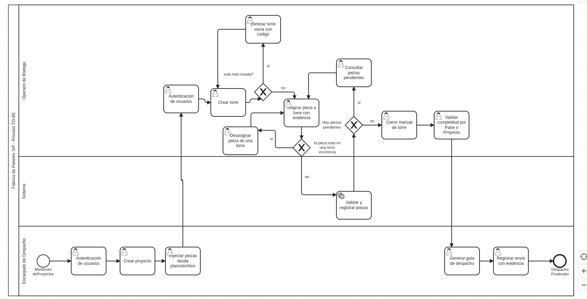

# Análisis de rediseño y propuesta TO-BE
 
## Mejoras identificadas por participante
| Participante | Objetivo | Problema | Mejora deseada |
|----------------|----------|----------|-----------------|
| Operario de Bodega | Armar las torres de paneles correctamente según la parte de la casa. | Asignación manual de piezas propensa a errores humanos y desorden físico. | Sistema digital que valide qué piezas faltan en tiempo real y permita registro ágil. |
| Encargado de Despacho | Enviar los camiones con el 100% de las piezas requeridas para un proyecto. | Despachos incompletos por falta de visibilidad del estado de las torres, generando sobrecostos por fletes. | Bloqueo estricto del despacho hasta asegurar la completitud del proyecto con evidencia visual. |
 
## Iniciativas de rediseño

### Iniciativa 1: Ingreso estructurado del universo de piezas
- Actividad(es) del AS-IS que afecta: Recepción y lectura de planos / Ingreso manual de piezas.
- Heurística aplicada: **Automatización / Captura de datos en el origen**
- Objetivo o mejora que resuelve: Evitar el ingreso manual pieza por pieza, mitigando errores de tipeo y acelerando el inicio del control.
- Efecto esperado (tiempo/costo/calidad/flexibilidad): Reducción del tiempo de inicio de proyecto y aumento de la calidad (cero piezas omitidas al inyectar un CSV/Excel).

### Iniciativa 2: Validación fotográfica in situ
- Actividad(es) del AS-IS que afecta: Marcado físico de la pieza en bodega / Verificación de completitud.
- Heurística aplicada: **Poka-Yoke (Prevención de errores) / Trazabilidad**
- Objetivo o mejora que resuelve: Asegurar que la pieza realmente existe físicamente en la torre, evitando marcas falsas.
- Efecto esperado (tiempo/costo/calidad/flexibilidad): Aumento drástico de la calidad del inventario despachado y reducción de costos por fletes de reposición.

### Iniciativa 3: Bloqueo sistémico de la Guía de Despacho
- Actividad(es) del AS-IS que afecta: Generación de documento de despacho / Control de salida del camión.
- Heurística aplicada: **Control basado en reglas de negocio (Business Rule Task)**
- Objetivo o mejora que resuelve: Impedir que un camión salga si falta una sola pieza del proyecto.
- Efecto esperado (tiempo/costo/calidad/flexibilidad): Eliminación del costo por envíos incompletos (calidad y costo).
 
## Diagrama TO-BE
## Diagrama TO-BE

 

 
Nota: El diagrama distingue tareas de usuario (marcadas con el icono de usuario) y tareas de servicio automatizadas por el sistema (marcadas con el icono de engranaje).
 
## Actividades que cambian del AS-IS al TO-BE
| Actividad en el AS-IS | Actividad en el TO-BE | Qué cambia |
|-------------------------|--------------------------|------------|
| Ingresar proyecto manualmente en pizarra/cuaderno | Autenticación de usuarios | Pasa de un registro físico vulnerable a un registro digital estructurado. |
| Interpretar plano e ingresar piezas una a una | Inyectar piezas desde plano/archivo | El sistema inyecta el total de piezas desde un archivo, automatizando el registro inicial en estado "Pendiente". |
| Agrupar piezas físicamente sin registro | Registrar nueva torre | Se crea un contenedor lógico en el sistema (Torre) asociado a una parte específica de la casa. |
| Tachar pieza en el plano impreso | Asignar pieza a torre con evidencia| El operario marca la pieza en el sistema y se exige adjuntar evidencia fotográfica obligatoria. |
| Revisar torre físicamente para ver qué falta | Consultar piezas pendientes | El sistema filtra y muestra en tiempo real únicamente las piezas que faltan por asignar. |
| - | Cierre manual de torre | (Nueva activida d)El operario clausura la recepción de piezas en una torre por falta de espacio físico. |
| Revisión ocular de todas las torres | Validar completitud por Parte o Proyecto | El sistema valida automáticamente por detrás si el 100% de las piezas de un proyecto están en estado "Listo". |
| Escribir guía a mano o en Excel sin restricciones | Generar guía de despacho | El sistema genera el PDF de forma automatizada, condicionado estrictamente a la validación de completitud previa. |
| Despachar camión | Registrar envío con evidencia| Se exige tomar una fotografía de evidencia del camión cargado antes de dar de baja el inventario. |
| - | Eliminar torre vacía | (Nueva actividad) Borrado lógico protegido mediante código de confirmación. |
| Despachar pieza equivocada y arreglarlo en planta | Desasignar pieza de una torre | (Nueva actividad) Permite al operario corregir un error de asignación en terreno devolviendo la pieza a estado "Pendiente". |
