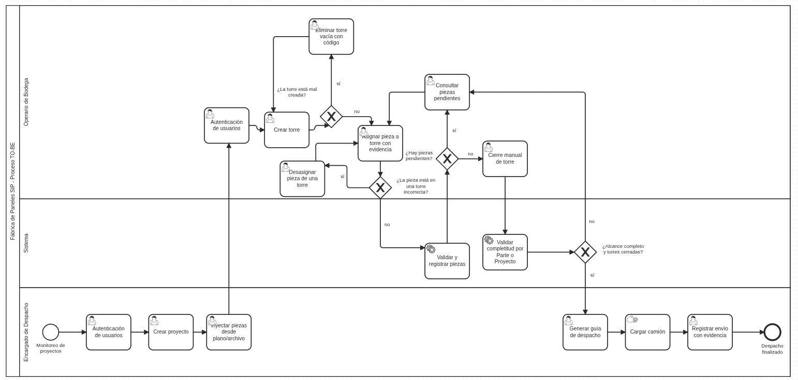

# Análisis de rediseño y propuesta TO-BE
 
## Mejoras identificadas por participante
| Participante | Objetivo | Problema | Mejora deseada |
|----------------|----------|----------|-----------------|
| Operario de Bodega | Armar las torres de paneles correctamente según la parte de la casa. | Asignación manual de piezas propensa a errores humanos y desorden físico. | Sistema digital que valide qué piezas faltan en tiempo real y permita registro ágil. |
| Encargado de Despacho | Enviar los camiones con el 100% de las piezas requeridas para un proyecto. | Despachos incompletos por falta de visibilidad del estado de las torres, generando sobrecostos por fletes. | Bloqueo estricto del despacho hasta asegurar la completitud del proyecto con evidencia visual. |
 
## Iniciativas de rediseño

### Iniciativa 1: Ingreso estructurado del universo de piezas
- Actividad(es) del AS-IS que afecta: Buscar freneticamente las piezas faltantes en la bodega (hoy no existe un listado de las piezas del proyecto contra el cual comparar).
- Heurística aplicada: **Automatización / Captura de datos en el origen**
- Objetivo o mejora que resuelve: Evitar el ingreso manual pieza por pieza, mitigando errores de tipeo y acelerando el inicio del control.
- Efecto esperado (tiempo/costo/calidad/flexibilidad): Reducción del tiempo de inicio de proyecto y aumento de la calidad (cero piezas omitidas al inyectar un CSV/Excel).

### Iniciativa 2: Validación fotográfica in situ
- Actividad(es) del AS-IS que afecta: Apilar torre verticalmente sobre otros proyectos o hacia el lado / Revisar visualmente las piezas mientras se carga el camion.
- Heurística aplicada: **Poka-Yoke (Prevención de errores) / Trazabilidad**
- Objetivo o mejora que resuelve: Asegurar que la pieza realmente existe físicamente en la torre, evitando marcas falsas.
- Efecto esperado (tiempo/costo/calidad/flexibilidad): Aumento drástico de la calidad del inventario despachado y reducción de costos por fletes de reposición.

### Iniciativa 3: Bloqueo sistémico de la Guía de Despacho
- Actividad(es) del AS-IS que afecta: Revisar visualmente las piezas mientras se carga el camion / Anotar pieza faltante para envio posterior / General Respaldo Manual.
- Heurística aplicada: **Control basado en reglas de negocio (Business Rule Task)**
- Objetivo o mejora que resuelve: Impedir que un camión salga si falta una sola pieza del proyecto.
- Efecto esperado (tiempo/costo/calidad/flexibilidad): Eliminación del costo por envíos incompletos (calidad y costo).
 
## Diagrama TO-BE

Archivo fuente: [`./diagramas/to-be.bpmn`](./diagramas/to-be.bpmn)

 
Nota: El diagrama distingue tareas de usuario (icono de persona), tareas de servicio que ejecuta el sistema de forma automática (icono de engranaje) y tareas manuales que se realizan sin apoyo del sistema (icono de mano), como Cargar camión. La compuerta «¿Alcance completo y torres cerradas?» materializa la Iniciativa 3: si la validación falla, no se genera la guía y el proceso vuelve a Consultar piezas pendientes.
 
## Actividades que cambian del AS-IS al TO-BE
| Actividad en el AS-IS | Actividad en el TO-BE | Qué cambia |
|-------------------------|--------------------------|------------|
| - | Autenticación de usuarios | (Nueva actividad) Cada usuario ingresa con sus credenciales y accede solo a las funciones de su rol. |
| - | Crear proyecto | (Nueva actividad) El proyecto queda registrado en el sistema con su cliente, código y metraje, en lugar de existir solo en papel. |
| - | Inyectar piezas desde plano/archivo | (Nueva actividad) El sistema inyecta el total de piezas desde un archivo, automatizando el registro inicial en estado "Pendiente". Así existe un listado contra el cual controlar lo que falta. |
| Apilar torre verticalmente sobre otros proyectos o hacia el lado | Crear torre | La torre deja de ser solo una pila física: se crea en el sistema asociada a un proyecto y a una parte específica de la casa. |
| Apilar torre verticalmente sobre otros proyectos o hacia el lado | Asignar pieza a torre con evidencia | Cada pieza que se apila queda registrada en su torre y se exige adjuntar evidencia fotográfica obligatoria. |
| Buscar freneticamente las piezas faltantes en la bodega | Consultar piezas pendientes | En lugar de buscar a ciegas durante la carga, el sistema muestra en tiempo real únicamente las piezas que faltan por asignar. |
| - | Cierre manual de torre | (Nueva actividad) El operario clausura la recepción de piezas en una torre por falta de espacio físico. |
| Revisar visualmente las piezas mientras se carga el camion / Anotar pieza faltante para envio posterior | Validar completitud por Parte o Proyecto | (Tarea de servicio) La revisión deja de ser visual y durante la carga: el sistema valida antes del despacho que el 100% de las piezas del alcance estén en estado "Listo", por lo que ya no se despachan piezas pendientes para un envío posterior. |
| Recibir orden de despacho | Generar guía de despacho | La orden de despacho pasa a ser una guía PDF generada por el sistema, condicionada estrictamente a la validación de completitud previa. |
| General Respaldo Manual | Registrar envío con evidencia | El respaldo manual (fotos o papeles) se reemplaza por el registro del envío en el sistema, con fotografía obligatoria del camión cargado. |
| - | Eliminar torre vacía con código | (Nueva actividad) Borrado lógico protegido mediante código de confirmación. |
| - | Desasignar pieza de una torre | (Nueva actividad) Permite al operario corregir un error de asignación devolviendo la pieza a estado "Pendiente", en lugar de detectarlo recién al cargar el camión. |
