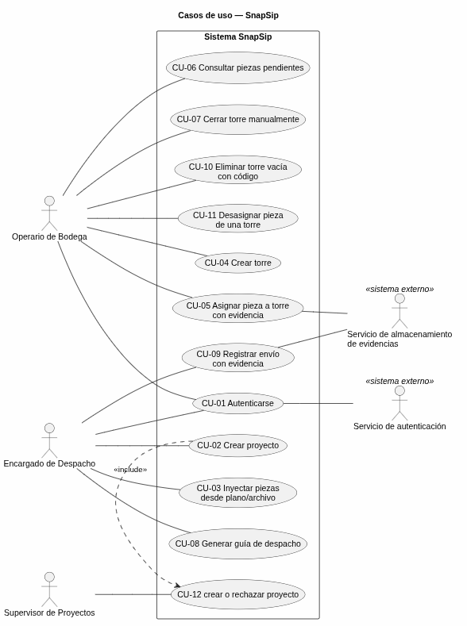

# Casos de uso

## Actores
| Actor | Tipo (humano / sistema externo) | Descripción |
|-------|----------------------------------|-------------|
| Operario de Bodega | Humano | Agrupa físicamente las piezas en torres y registra en el sistema cada asignación con evidencia fotográfica. |
| Encargado de Despacho | Humano | Crea los proyectos, inyecta las piezas desde el archivo, genera las guías de despacho y registra la salida de los camiones. |
| Servicio de autenticación | Sistema externo | Proveedor administrado que verifica las credenciales (identificador y contraseña) de los usuarios (RP-15b). |
| Servicio de almacenamiento de evidencias | Sistema externo | Repositorio en la nube que recibe y guarda las fotografías que respaldan la asignación de una pieza y el envío de un camión (RP-15a). |

## Diagrama de casos de uso

Archivo fuente: [`./diagramas/casos-de-uso.puml`](./diagramas/casos-de-uso.puml)

## Casos de uso y su origen
| ID | Caso de uso (objetivo del actor) | Actor principal | Sistema externo | Historia de origen |
|----|-----------------------------------|-----------------|-----------------|---------------------|
| CU-01 | Autenticarse | Operario de Bodega / Encargado de Despacho | Servicio de autenticación | [HU-01 Autenticación de usuarios](./04-historias-usuario.md#hu-01) |
| CU-02 | Crear proyecto | Encargado de Despacho | — | [HU-02 Crear proyecto](./04-historias-usuario.md#hu-02) |
| CU-03 | Inyectar piezas desde plano/archivo | Encargado de Despacho | — | [HU-03 Inyectar piezas desde plano/archivo](./04-historias-usuario.md#hu-03) |
| CU-04 | Crear torre | Operario de Bodega | — | [HU-04 Crear torre](./04-historias-usuario.md#hu-04) |
| CU-05 | Asignar pieza a torre con evidencia | Operario de Bodega | Servicio de almacenamiento de evidencias | [HU-05 Asignar pieza a torre con evidencia](./04-historias-usuario.md#hu-05) |
| CU-06 | Consultar piezas pendientes | Operario de Bodega | — | [HU-06 Consultar piezas pendientes](./04-historias-usuario.md#hu-06) |
| CU-07 | Cerrar torre manualmente | Operario de Bodega | — | [HU-07 Cierre manual de torre](./04-historias-usuario.md#hu-07) |
| CU-08 | Generar guía de despacho | Encargado de Despacho | — | [HU-08 Generar guía de despacho](./04-historias-usuario.md#hu-08) |
| CU-09 | Registrar envío con evidencia | Encargado de Despacho | Servicio de almacenamiento de evidencias | [HU-09 Registrar envío con evidencia](./04-historias-usuario.md#hu-09) |
| CU-10 | Eliminar torre vacía con código | Operario de Bodega | — | [HU-10 Eliminar torre vacía con código](./04-historias-usuario.md#hu-10) |
| CU-11 | Desasignar pieza de una torre | Operario de Bodega | — | [HU-11 Desasignar pieza de una torre](./04-historias-usuario.md#hu-11) |
| CU-12  | Crear o Rechazar Proyecto | Supervisor de proyectos |
| - | HU-12 Crear o Rechazar Proyecto |

## Decisiones de modelado
- **Un caso de uso por historia:** cada historia de [04-historias-usuario.md](./04-historias-usuario.md) corresponde a un único objetivo del actor, por lo que la numeración CU-xx coincide con la HU-xx de origen.
- **Nombre del caso de uso:** cada caso de uso se escribe con un verbo en infinitivo que expresa el objetivo del actor, tomado del «quiero…» de su historia. En nueve casos ese verbo coincide con eleccion del título de la historia y con la tarea del [diagrama TO-BE](./02-rediseno-to-be.md). En CU-01 y CU-07 el título es un sustantivo («Autenticación de usuarios», «Cierre manual de torre»), por lo que el caso de uso usa el verbo de la historia: «quiero autenticarme» y «quiero cerrar manualmente una torre».
- **Tareas del TO-BE sin caso de uso propio:** «Validar y registrar piezas» y «Validar completitud por Parte o Proyecto» son tareas de servicio que ejecuta el sistema dentro de CU-05 y CU-08. «Cargar camión» es una tarea manual, sin apoyo del sistema.
- **Validación de completitud dentro de CU-08:** la ejecuta el sistema y no es un objetivo de un actor. CU-08 solo genera la guía si el alcance solicitado está completo (RP-08, RP-09).
- **Adjuntar evidencia fotográfica sin caso de uso propio:** es un paso obligatorio de CU-05 y de CU-09, no un objetivo independiente. Por eso el Servicio de almacenamiento de evidencias se conecta directamente con esos dos casos de uso.
- **Reasignación dentro de CU-05:** cambiar una pieza de torre es una variante de asignar pieza a torre, con confirmación del reemplazo y nueva evidencia (HU-05 CA3). No se modela como un caso de uso aparte.
- **Reapertura dentro de CU-07:** reabrir una torre Cerrada corrige un cierre y proviene de la misma historia (HU-07 CA3 y CA4). Se trata como una variante de CU-07 y no como un caso de uso aparte.
- **Sin include ni extend:** como la evidencia, la reasignación y la reapertura quedan dentro de sus casos de uso base, el diagrama no necesita estas relaciones.
