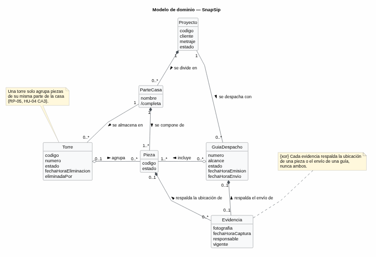

# Casos de uso
 
## Actores
| Actor | Tipo (humano / sistema externo) | Descripción |
|-------|----------------------------------|-------------|
| Operario de Bodega | Humano | Encargado de agrupar las piezas en torres físicamente y registrar la asignación con evidencia en el sistema. |
| Encargado de Despacho | Humano | Responsable de crear los proyectos, cargar el universo de piezas, emitir las guías y registrar la salida de los camiones. |
| Servicio de Autenticación | Sistema externo | Proveedor encargado de validar las credenciales (identificador y clave) y gestionar el acceso según el rol. |
| Servicio de almacenamiento de evidencia | Sistema externo | Repositorio en la nube encargado de recibir, guardar de forma segura y proveer los enlaces de las fotografías de respaldo. |
 
## Diagrama de casos de uso

 
Archivo fuente: [`./diagramas/casos-de-uso.puml`](./diagramas/casos-de-uso.puml)
 
## Casos de uso y su origen
| ID | Caso de uso (objetivo del actor) | Actor principal | Historia de origen |
|----|-----------------------------------|-----------------|---------------------|
| CU-01 | Iniciar sesión | Operario de Bodega / Encargado de Despacho | [HU-01](./04-historias-usuario.md#hu-01) |
| CU-02 | Registrar proyecto | Encargado de Despacho | [HU-02](./04-historias-usuario.md#hu-02) |
| CU-03 | Cargar universo de piezas | Encargado de Despacho | [HU-03](./04-historias-usuario.md#hu-03) |
| CU-04 | Registrar torre | Operario de Bodega | [HU-04](./04-historias-usuario.md#hu-04) |
| CU-05 | Asignar pieza a torre | Operario de Bodega | [HU-05](./04-historias-usuario.md#hu-05) |
| CU-06 | Consultar piezas pendientes | Operario de Bodega | [HU-06](./04-historias-usuario.md#hu-06) |
| CU-07 | Cerrar torre | Operario de Bodega | [HU-07](./04-historias-usuario.md#hu-07) |
| CU-09 | Generar guía de despacho | Encargado de Despacho | [HU-09](./04-historias-usuario.md#hu-09) |
| CU-10 | Registrar envío | Encargado de Despacho | [HU-10](./04-historias-usuario.md#hu-10) |
| CU-11 | Eliminar torre vacía | Operario de Bodega | [HU-11](./04-historias-usuario.md#hu-11) |
| CU-12 | Desasignar pieza | Operario de Bodega | [HU-12](./04-historias-usuario.md#hu-12) |
