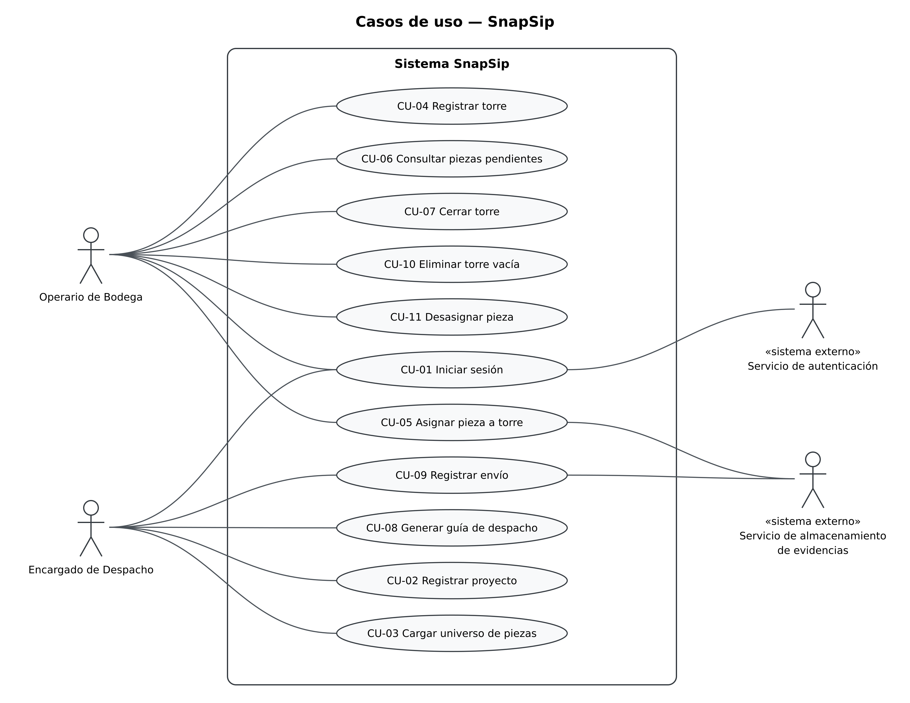

# Casos de uso

## Actores
| Actor | Tipo (humano / sistema externo) | Descripción |
|-------|----------------------------------|-------------|
| Operario de Bodega | Humano | Agrupa físicamente las piezas en torres y registra en el sistema cada asignación con evidencia fotográfica. |
| Encargado de Despacho | Humano | Registra los proyectos, carga el universo de piezas, genera las guías de despacho y registra la salida de los camiones. |
| Servicio de autenticación | Sistema externo | Proveedor administrado que verifica las credenciales (identificador y contraseña) de los usuarios (RP-15b). |
| Servicio de almacenamiento de evidencias | Sistema externo | Repositorio en la nube que recibe y guarda las fotografías que respaldan la asignación de una pieza y el envío de un camión (RP-15a). |

## Diagrama de casos de uso

Archivo fuente: [`./diagramas/casos-de-usooo.puml`](./diagramas/casos-de-uso.puml)

## Casos de uso y su origen
| ID | Caso de uso (objetivo del actor) | Actor principal | Sistema externo | Historia de origen |
|----|-----------------------------------|-----------------|-----------------|---------------------|
| CU-01 | Iniciar sesión | Operario de Bodega / Encargado de Despacho | Servicio de autenticación | [HU-01](./04-historias-usuario.md#hu-01) |
| CU-02 | Registrar proyecto | Encargado de Despacho | — | [HU-02](./04-historias-usuario.md#hu-02) |
| CU-03 | Cargar universo de piezas | Encargado de Despacho | — | [HU-03](./04-historias-usuario.md#hu-03) |
| CU-04 | Registrar torre | Operario de Bodega | — | [HU-04](./04-historias-usuario.md#hu-04) |
| CU-05 | Asignar pieza a torre | Operario de Bodega | Servicio de almacenamiento de evidencias | [HU-05](./04-historias-usuario.md#hu-05) |
| CU-06 | Consultar piezas pendientes | Operario de Bodega | — | [HU-06](./04-historias-usuario.md#hu-06) |
| CU-07 | Cerrar torre | Operario de Bodega | — | [HU-07](./04-historias-usuario.md#hu-07) |
| CU-08 | Generar guía de despacho | Encargado de Despacho | — | [HU-08](./04-historias-usuario.md#hu-08) |
| CU-09 | Registrar envío | Encargado de Despacho | Servicio de almacenamiento de evidencias | [HU-09](./04-historias-usuario.md#hu-09) |
| CU-10 | Eliminar torre vacía | Operario de Bodega | — | [HU-10](./04-historias-usuario.md#hu-10) |
| CU-11 | Desasignar pieza | Operario de Bodega | — | [HU-11](./04-historias-usuario.md#hu-11) |

## Decisiones de modelado
- **Un caso de uso por historia:** cada historia de [04-historias-usuario.md](./04-historias-usuario.md) corresponde a un único objetivo del actor, por lo que la numeración CU-xx coincide con la HU-xx de origen.
- **Validación de completitud dentro de CU-08:** la ejecuta el sistema y no es un objetivo de un actor. CU-08 solo genera la guía si el alcance solicitado está completo (RP-08, RP-09).
- **Adjuntar evidencia fotográfica sin caso de uso propio:** es un paso obligatorio de CU-05 y de CU-09, no un objetivo independiente. Por eso el Servicio de almacenamiento de evidencias se conecta directamente con esos dos casos de uso.
- **Reasignación dentro de CU-05:** cambiar una pieza de torre es una variante de asignar pieza a torre, con confirmación del reemplazo y nueva evidencia (HU-05). No se modela como un caso de uso aparte.
- **Sin include ni extend:** como la evidencia y la reasignación quedan dentro de sus casos de uso base, el diagrama no necesita estas relaciones.
