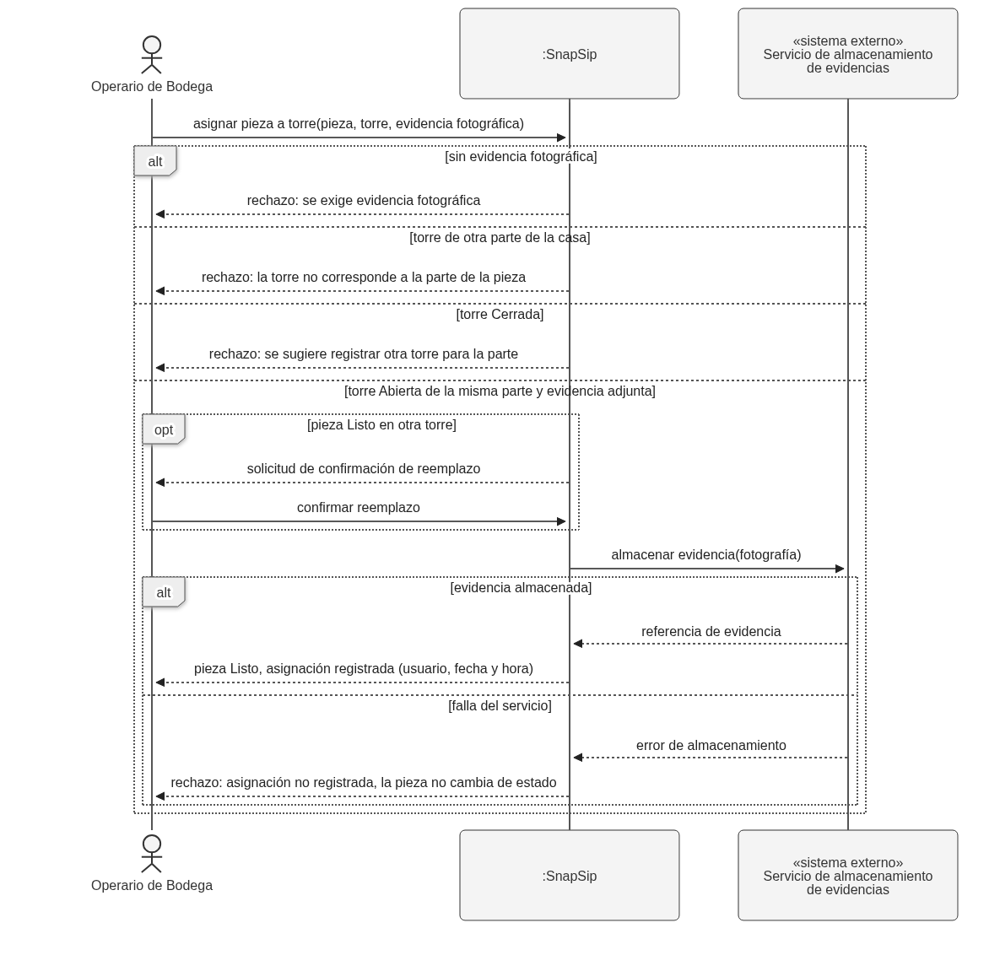
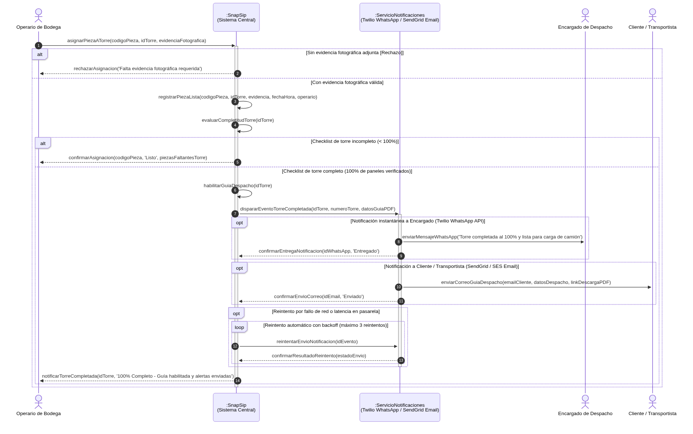

# Diagramas de secuencia de sistema

En este documento se presentan los **Diagramas de Secuencia de Sistema (DSS)** para el proyecto **SnapSip**, elaborados bajo el estándar **UML 2.0**. De acuerdo con los principios metodológicos de análisis de requisitos, el sistema SnapSip se modela como una **caja negra única** (`:SnapSip`), interactuando exclusivamente a través de eventos y mensajes expresados en el lenguaje del negocio con los actores humanos y los sistemas externos integrados.

---

## DSS-01 — Autenticación de usuario mediante Proveedor de Identidad externo

- **Caso de uso:** Iniciar sesión en el sistema
- **Historia:** [HU-01 — Autenticación de usuarios](./04-historias-usuario.md#hu-01)
- **Sistemas externos que participan:** Proveedor de Identidad / Autenticación (Google Workspace OAuth 2.0 / Auth0)

### Contexto del negocio e integración externa
Para garantizar un acceso seguro y simplificado al personal de faena y bodega, SnapSip delega la autenticación en un **Proveedor de Identidad corporativo (IdP)**. Esto permite a los operarios y encargados ingresar con un solo clic utilizando su correo corporativo institucional, eliminando la necesidad de que SnapSip almacene hashes de contraseñas ni gestione flujos de reseteo de claves locales.

### Diagrama

Archivo fuente: [`./diagramas/dss-01.puml`](./diagramas/dss-01.puml)

### Variantes representadas
- **`alt` (Credenciales corporativas válidas vs. inválidas / cuenta no autorizada):**
  - **Escenario principal (Éxito):** El usuario provee sus credenciales corporativas correctas en el IdP. El proveedor emite un token de acceso seguro y el perfil del usuario. SnapSip valida la sesión y habilita el acceso con el rol asignado (Operario o Encargado).
  - **Escenario alternativo / error (Fallo):** Si las credenciales son incorrectas o la cuenta no pertenece a la organización autorizada, el proveedor externo rechaza la solicitud, SnapSip audita el evento y el sistema deniega el acceso al usuario con un mensaje claro de error.
- **`opt` (Aprovisionamiento Just-In-Time / Primer inicio de sesión):**
  - Cuando un colaborador institucional ingresa por primera vez a SnapSip, el sistema aprovisiona de forma transparente su registro local a partir de los datos recibidos del proveedor de identidad, asignando el rol operativo preconfigurado sin requerir registro manual previo.

---

## DSS-02 — Asignación de pieza con completitud al 100% y Notificación Automática de Despacho

- **Caso de uso:** Asignar pieza a torre (y validación de completitud)
- **Historia:** [HU-05 — Asignar pieza a torre con evidencia](./04-historias-usuario.md#hu-05--asignar-pieza-a-torre-con-evidencia) (asociada a [HU-08 — Validar completitud](./04-historias-usuario.md#hu-08--validar-completitud-por-parte-o-proyecto) y [HU-09 — Generar guía de despacho](./04-historias-usuario.md#hu-09--generar-guía-de-despacho))
- **Sistemas externos que participan:** Servicio de Notificaciones y Mensajería Automática (Twilio WhatsApp API / SendGrid Email)

### Contexto del negocio e integración externa
- **¿Cómo se conecta con SnapSip?**
  Cuando el operario marca el último panel del checklist de una torre alcanzando el 100% de completitud física verificada, SnapSip habilita inmediatamente la Guía de Despacho oficial en PDF. En ese instante exacto, SnapSip dispara una notificación automática asíncrona mediante APIs de mensajería:
  - **Al Encargado de Despacho:** Alerta por WhatsApp vía Twilio API informando: *"Torre completada al 100% y lista para carga de camión"*.
  - **Al Cliente / Transportista:** Correo formal vía SendGrid / AWS SES con los detalles del despacho y el enlace de descarga de la Guía de Despacho en PDF.
- **¿Por qué NO cambia el uso del sistema?**
  Es un proceso reactivo por eventos en segundo plano (webhooks/APIs). El operario en bodega no tiene que redactar correos, enviar mensajes ni coordinar por radio: únicamente realiza su trabajo regular marcando el panel verificado con fotografía, y el sistema se encarga del resto.
- **Beneficio metodológico:**
  Reduce drásticamente los tiempos muertos de espera y coordinación en bodega, asegura trazabilidad total del proceso TO-BE y elimina la carga cognitiva del trabajador en terreno.

### Diagrama

Archivo fuente: [`./diagramas/dss-02.puml`](./diagramas/dss-02.puml)

### Variantes representadas
- **`alt` (Validación de evidencia fotográfica - CA2 de HU-05):**
  - **Fallo de precondición:** Si el operario intenta marcar una pieza sin fotografía, SnapSip rechaza la acción exigiendo la evidencia obligatoria.
  - **Asignación válida:** Si se incluye la fotografía, el sistema registra la pieza como "Listo" con marca de tiempo y autor.
- **`alt` (Evaluación de completitud de la torre):**
  - **Torre en proceso (< 100%):** SnapSip actualiza el progreso y confirma la asignación individual sin disparar notificaciones de despacho.
  - **Torre completada (100%):** Al verificar la última pieza, el sistema cambia el estado a completado, habilita el botón de descarga de la Guía de Despacho en PDF (cumpliendo el requisito derivado de RP-07) y despacha el evento de integración externa.
- **`opt` (Canal WhatsApp a Encargado de Despacho):**
  - Envío automático de alerta operativa al móvil del encargado mediante la API de Twilio.
- **`opt` (Canal Email a Cliente y Transportista):**
  - Envío de correo corporativo transaccional mediante SendGrid con la información consolidada y el enlace de descarga de la guía en PDF.
- **`opt` + `loop` (Mecanismo resiliente de reintento ante latencia o fallos de conexión):**
  - Ante una eventual falla de conectividad temporal con la pasarela de notificaciones, SnapSip ejecuta un bucle de reintento en segundo plano con retroceso exponencial (hasta 3 intentos), asegurando que ninguna notificación crítica de despacho se pierda sin bloquear la experiencia del usuario.
