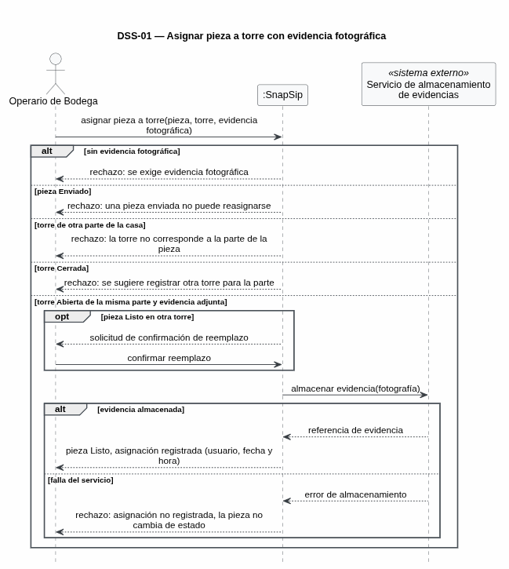
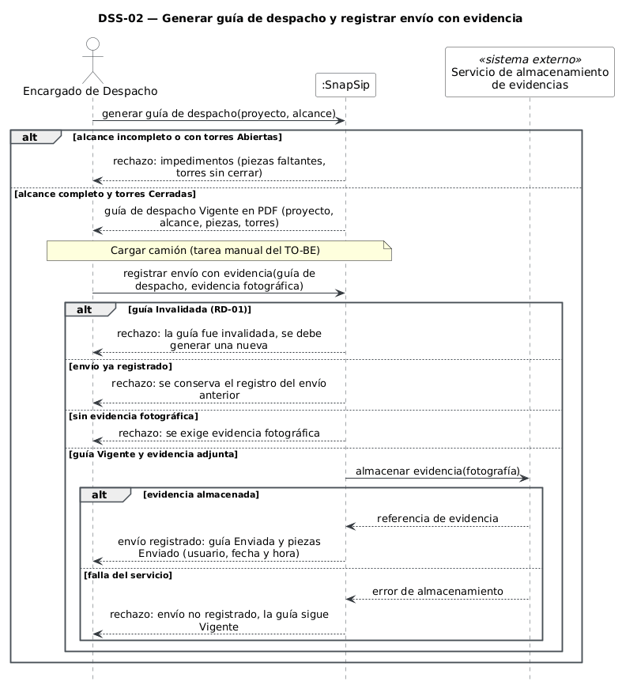
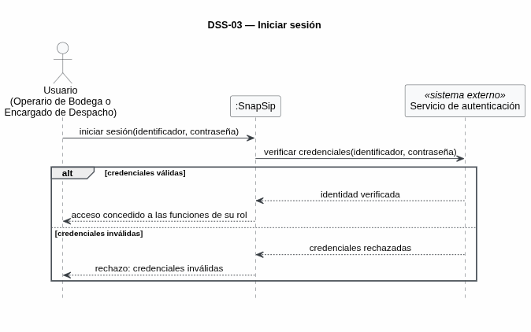

# Diagramas de secuencia de sistema

Este documento presenta los diagramas de secuencia de sistema (DSS) de **SnapSip** en notación UML 2.0. En cada diagrama, SnapSip es una **sola caja negra** (`:SnapSip`): solo se muestran los mensajes que intercambia con los actores humanos y con los sistemas externos. Los mensajes usan el vocabulario del negocio, y los que cambian el estado de un objeto del dominio llevan el mismo nombre que el evento correspondiente en los [diagramas de estado](./11-diagramas-estado.md).

Se diagraman las tres historias que se integran con otro sistema: HU-05 y HU-09 con el Servicio de almacenamiento de evidencias, y HU-01 con el Servicio de autenticación.

Notación utilizada:

- Flecha continua: mensaje enviado.
- Flecha punteada: respuesta.
- `alt`: escenarios alternativos excluyentes, cada uno con su condición entre corchetes.
- `opt`: comportamiento que ocurre solo si se cumple la condición indicada.

---

## DSS-01 — Asignar pieza a torre con evidencia

- Caso de uso: [CU-05 Asignar pieza a torre con evidencia](./09-casos-de-uso.md)
- Historia: [HU-05 Asignar pieza a torre con evidencia](./04-historias-usuario.md#hu-05)
- Requisitos: RP-04, RP-05, RP-13, RP-15a
- Sistemas externos que participan: Servicio de almacenamiento de evidencias

Archivo fuente: [`./diagramas/dss-01.puml`](./diagramas/dss-01.puml)

Variantes representadas:

- **`alt` de validación de la solicitud**, con cinco escenarios excluyentes:
  - **[sin evidencia fotográfica]:** SnapSip rechaza la asignación y exige la fotografía (HU-05 CA2).
  - **[pieza Enviado]:** SnapSip rechaza la solicitud, porque una pieza enviada no puede reasignarse (HU-05 CA5).
  - **[torre de otra parte de la casa]:** SnapSip rechaza la asignación, porque cada torre pertenece a una sola parte de la casa (HU-04 CA3).
  - **[torre Cerrada]:** SnapSip rechaza la asignación y sugiere registrar otra torre para esa parte (HU-04 CA4).
  - **[torre Abierta de la misma parte y evidencia adjunta]:** es el escenario principal y continúa con el almacenamiento de la evidencia.
- **`opt` [pieza Listo en otra torre]:** si la pieza ya estaba asignada, SnapSip solicita la confirmación del reemplazo antes de reasignarla (HU-05 CA3). Si el operario no confirma, la secuencia termina y la asignación anterior se conserva.
- **`alt` del almacenamiento de la evidencia en el sistema externo:**
  - **[evidencia almacenada]:** la pieza queda en estado Listo y se registran el usuario, la fecha y la hora de la asignación (HU-05 CA1).
  - **[falla del servicio]:** SnapSip rechaza la asignación y la pieza no cambia de estado (HU-05 CA4). Así nunca queda una pieza Listo sin evidencia que la respalde.

---

## DSS-02 — Generar guía de despacho y registrar envío con evidencia

- Caso de uso: [CU-09 Registrar envío con evidencia](./09-casos-de-uso.md), precedido por [CU-08 Generar guía de despacho](./09-casos-de-uso.md)
- Historia: [HU-09 Registrar envío con evidencia](./04-historias-usuario.md#hu-09), precedida por [HU-08 Generar guía de despacho](./04-historias-usuario.md#hu-08)
- Requisitos: RP-08, RP-09, RP-10, RP-12, RP-14, RP-15a, RD-01
- Sistemas externos que participan: Servicio de almacenamiento de evidencias

La integración con el sistema externo ocurre en CU-09. El diagrama incluye antes la generación de la guía (CU-08) porque un envío solo puede registrarse sobre una guía generada y Vigente (RP-10), y porque entre ambos momentos la guía puede quedar Invalidada (RD-01).

Archivo fuente: [`./diagramas/dss-02.puml`](./diagramas/dss-02.puml)

Variantes representadas:

- **`alt` de la generación de la guía:**
  - **[alcance incompleto o con torres Abiertas]:** SnapSip rechaza la generación e informa los impedimentos (HU-08 CA2 y CA4; RP-09). Un alcance sin piezas o con piezas ya enviadas tampoco está completo y recibe el mismo rechazo (HU-08 CA7 y CA8).
  - **[alcance completo y torres Cerradas]:** SnapSip entrega la guía de despacho en PDF, en estado Vigente, con el proyecto, el alcance, las piezas y las torres (HU-08 CA1, CA3 y CA5).
- **Nota «Cargar camión»:** corresponde a la tarea manual «Cargar camión» del [diagrama TO-BE](./02-rediseno-to-be.md), que ocurre fuera del sistema entre la generación de la guía y el registro del envío. Durante ese tiempo la guía puede quedar Invalidada.
- **`alt` del registro del envío**, con cuatro escenarios excluyentes:
  - **[guía Invalidada (RD-01)]:** SnapSip rechaza el registro y exige generar una guía nueva (HU-09 CA3 y CA4). Es el efecto de desasignar o reasignar una pieza incluida en la guía, o de reabrir una torre incluida (RD-01).
  - **[envío ya registrado]:** SnapSip rechaza el registro y conserva el envío anterior (HU-09 CA5).
  - **[sin evidencia fotográfica]:** SnapSip rechaza el registro y exige la fotografía del camión cargado (HU-09 CA2).
  - **[guía Vigente y evidencia adjunta]:** es el escenario principal y continúa con el almacenamiento de la evidencia.
- **`alt` del almacenamiento de la evidencia en el sistema externo:**
  - **[evidencia almacenada]:** la guía queda en estado Enviada, sus piezas en estado Enviado, y se registran el usuario, la fecha y la hora del envío (HU-09 CA1; RP-10).
  - **[falla del servicio]:** SnapSip rechaza el registro, la guía sigue Vigente y las piezas no cambian de estado (HU-09 CA6).

---

## DSS-03 — Autenticarse

- Caso de uso: [CU-01 Autenticarse](./09-casos-de-uso.md)
- Historia: [HU-01 Autenticación de usuarios](./04-historias-usuario.md#hu-01)
- Requisitos: RP-01, RP-14, RP-15a, RP-15b, RP-16
- Sistemas externos que participan: Servicio de autenticación

SnapSip delega la verificación de credenciales en un servicio de autenticación administrado, opción que RP-15b contempla. Participan los tres roles humanos del sistema: Operario de Bodega, Encargado de Despacho y Supervisor de proyectos. SnapSip conserva el control de acceso según el rol del usuario (RP-16).

Archivo fuente: [`./diagramas/dss-03.puml`](./diagramas/dss-03.puml)

Variantes representadas:

- **`alt` de la verificación de credenciales:**
  - **[credenciales válidas]:** el servicio confirma la identidad y SnapSip concede el acceso a las funciones del rol del usuario (HU-01 CA1).
  - **[credenciales inválidas]:** el servicio rechaza las credenciales y SnapSip informa que son inválidas (HU-01 CA2).

---

## Correspondencia entre mensajes y eventos de estado

Cada mensaje de un actor lleva el nombre de su caso de uso en minúscula. Los que cambian el estado de un objeto del dominio aparecen con ese mismo nombre como evento en los [diagramas de estado](./11-diagramas-estado.md):

| Mensaje del actor | DSS | Evento en diagrama de estado | Diagrama de estado |
|---|---|---|---|
| asignar pieza a torre con evidencia | DSS-01 | asignar pieza a torre con evidencia | EST-01 (Pieza), EST-03 (GuiaDespacho, cuando es una reasignación) |
| generar guía de despacho | DSS-02 | generar guía de despacho | EST-03 (GuiaDespacho) |
| registrar envío con evidencia | DSS-02 | registrar envío con evidencia | EST-01 (Pieza), EST-02 (Torre), EST-03 (GuiaDespacho) |
| autenticarse | DSS-03 | — (no cambia el estado de ningún objeto del dominio) | — |

Los demás eventos de los diagramas de estado pertenecen a casos de uso que no se integran con sistemas externos, por lo que no tienen un diagrama de secuencia propio:

| Evento en diagrama de estado | Caso de uso | Diagrama de estado |
|---|---|---|
| inyectar piezas desde plano/archivo | [CU-03 Inyectar piezas desde plano/archivo](./09-casos-de-uso.md) | EST-01 |
| crear torre | [CU-04 Crear torre](./09-casos-de-uso.md) | EST-02 |
| cerrar torre manualmente | [CU-07 Cerrar torre manualmente](./09-casos-de-uso.md) | EST-02 |
| reabrir torre | [CU-07 Cerrar torre manualmente](./09-casos-de-uso.md) (variante de HU-07 CA3) | EST-02, EST-03 |
| eliminar torre vacía con código | [CU-10 Eliminar torre vacía con código](./09-casos-de-uso.md) | EST-02 |
| desasignar pieza de una torre | [CU-11 Desasignar pieza de una torre](./09-casos-de-uso.md) | EST-01, EST-03 |

`desasignar pieza de una torre` y `reabrir torre`, igual que la reasignación de DSS-01, invalidan la guía en EST-03 (RD-01). En DSS-02 se representa ese efecto: la variante [guía Invalidada (RD-01)].
