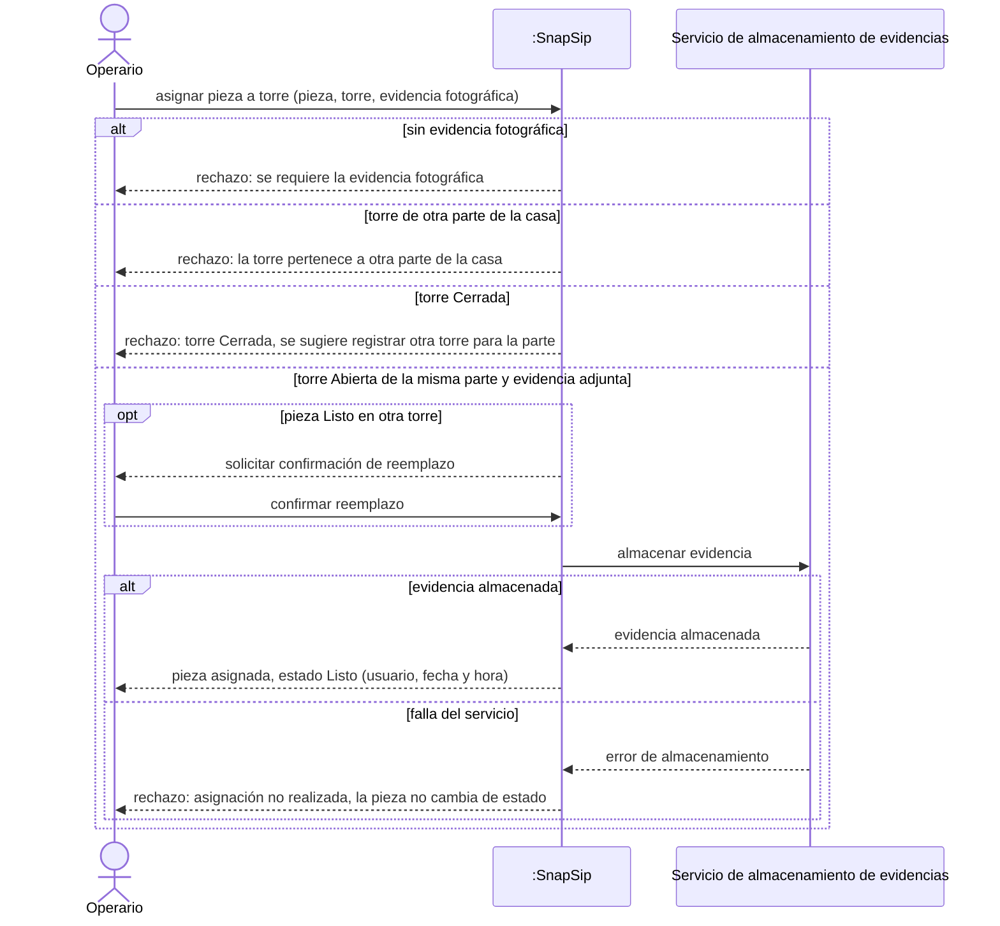
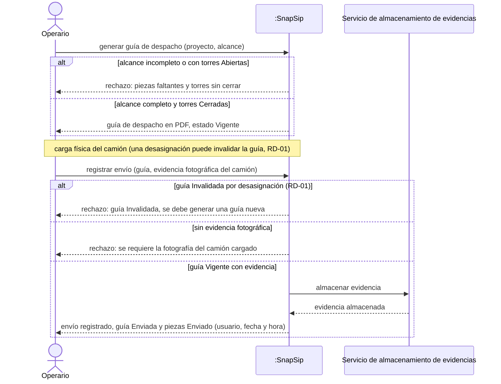
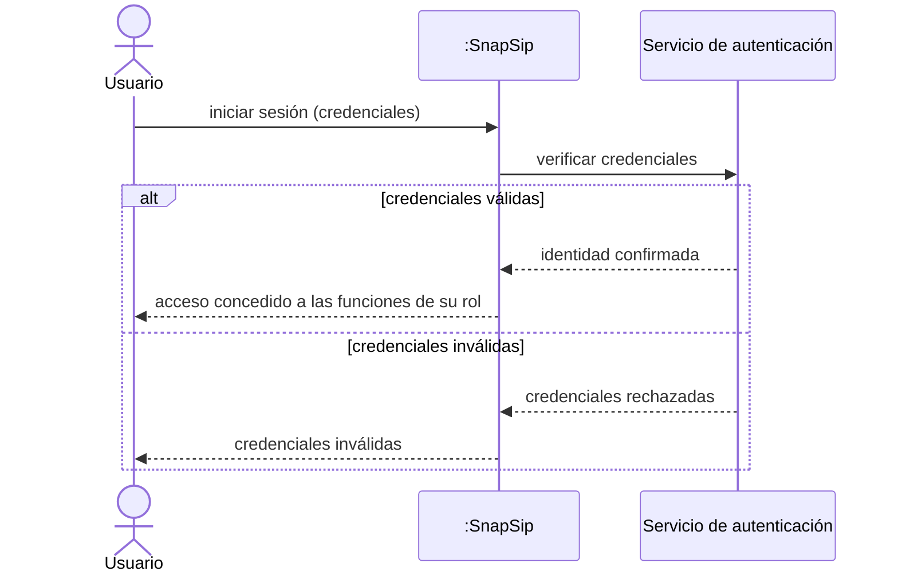

# Diagramas de secuencia de sistema

Este documento presenta los Diagramas de Secuencia de Sistema (DSS) de **SnapSip** en notación UML 2.0. En cada diagrama, SnapSip se modela como una **caja negra única** (`:SnapSip`): solo se muestran los mensajes que intercambia con los actores humanos y con los sistemas externos, sin descomponer su funcionamiento interno. Los mensajes usan el vocabulario del negocio y coinciden con los eventos de los [diagramas de estado](./11-diagramas-estado.md) y con los términos del [modelo de dominio](./08-modelo-dominio.md).

Notación utilizada:

- Flecha continua (`→`): solicitud o mensaje enviado.
- Flecha punteada (`⇠`): respuesta.
- `alt`: escenarios alternativos excluyentes; el primero que cumple su condición es el que ocurre.
- `opt`: comportamiento que ocurre solo si se cumple la condición indicada.

---

## DSS-01 — Asignar pieza a torre con evidencia fotográfica

- Caso de uso: [CU-05 Asignar pieza a torre](./09-casos-de-uso.md) (incluye [CU-13 Adjuntar evidencia fotográfica](./09-casos-de-uso.md))
- Historia: [HU-05](./04-historias-usuario.md#hu-05)
- Requisitos que cubre: RP-05, RP-04 (pertenencia de la torre a una parte de la casa)
- Sistemas externos que participan: Servicio de almacenamiento de evidencias

Archivo fuente: [`./diagramas/dss-01.mmd`](./diagramas/dss-01.mmd)

Variantes representadas:

- **`alt` de validación de la solicitud.** Hay cuatro escenarios excluyentes:
  - **[sin evidencia fotográfica]:** SnapSip rechaza la asignación y exige la fotografía. Corresponde a HU-05 CA2.
  - **[torre de otra parte de la casa]:** SnapSip rechaza la asignación porque cada torre pertenece a una sola parte de la casa. Corresponde a HU-04 CA3.
  - **[torre Cerrada]:** SnapSip rechaza la asignación y sugiere registrar otra torre para esa parte. Corresponde a HU-04 CA4.
  - **[torre Abierta de la misma parte y evidencia adjunta]:** es el escenario principal y continúa con el almacenamiento de la evidencia.
- **`opt` [pieza Listo en otra torre].** Si la pieza ya estaba asignada, SnapSip solicita la confirmación del reemplazo antes de reasignarla. Corresponde a HU-05 CA3.
- **`alt` del almacenamiento de la evidencia en el sistema externo:**
  - **[evidencia almacenada]:** la pieza pasa a estado Listo y se registran el usuario, la fecha y la hora de la asignación. Corresponde a HU-05 CA1.
  - **[falla del servicio]:** SnapSip rechaza la asignación y la pieza no cambia de estado. Así nunca queda una pieza Listo sin evidencia que la respalde.

---

## DSS-02 — Generar guía de despacho y registrar envío con evidencia

- Caso de uso: [CU-10 Registrar envío](./09-casos-de-uso.md), precedido por [CU-09 Generar guía de despacho](./09-casos-de-uso.md), que es su condición previa. CU-10 incluye [CU-13 Adjuntar evidencia fotográfica](./09-casos-de-uso.md).
- Historia: [HU-10](./04-historias-usuario.md#hu-10), precedida por [HU-09](./04-historias-usuario.md#hu-09)
- Requisitos que cubre: RP-09, RP-10, RD-01
- Sistemas externos que participan: Servicio de almacenamiento de evidencias

Los dos casos de uso se muestran en un solo diagrama porque un envío solo puede registrarse sobre una guía generada y Vigente (RP-10). Además, entre ambos momentos puede ocurrir la invalidación de la guía definida en RD-01.

Archivo fuente: [`./diagramas/dss-02.mmd`](./diagramas/dss-02.mmd)

Variantes representadas:

- **`alt` de la generación de la guía:**
  - **[alcance incompleto o con torres Abiertas]:** SnapSip rechaza la generación e informa las piezas faltantes y las torres sin cerrar. Corresponde a HU-09 CA2 y RP-09.
  - **[alcance completo y torres Cerradas]:** SnapSip entrega la guía de despacho en PDF, en estado Vigente, con el proyecto, el alcance, las piezas y las torres. Corresponde a HU-09 CA1.
- **Nota "carga física del camión".** Indica el tiempo que transcurre en bodega entre la generación de la guía y el registro del envío. Durante ese tiempo, una desasignación puede invalidar la guía.
- **`alt` del registro del envío:**
  - **[guía Invalidada por desasignación (RD-01)]:** SnapSip rechaza el registro y exige generar una guía nueva. Corresponde a la verificación de RD-01.
  - **[sin evidencia fotográfica]:** SnapSip rechaza el registro y exige la fotografía del camión cargado. Corresponde a HU-10 CA2.
  - **[guía Vigente con evidencia]:** es el escenario principal. SnapSip almacena la evidencia en el servicio externo, la guía pasa a estado Enviada y las piezas a estado Enviado, y se registran el usuario, la fecha y la hora. Corresponde a HU-10 CA1 y RP-10.

---

## DSS-03 — Iniciar sesión

- Caso de uso: [CU-01 Iniciar sesión](./09-casos-de-uso.md)
- Historia: [HU-01](./04-historias-usuario.md#hu-01)
- Requisitos que cubre: RP-01, RP-15b (autenticación administrada), RP-16 (acceso según rol)
- Sistemas externos que participan: Servicio de autenticación

SnapSip delega la verificación de credenciales en un servicio de autenticación administrado. RP-15b lo permite expresamente: "Si se utiliza autenticación administrada, debe verificarse el mecanismo del proveedor". SnapSip conserva el control de acceso según el rol del usuario (RP-16).

Archivo fuente: [`./diagramas/dss-03.mmd`](./diagramas/dss-03.mmd)

Variantes representadas:

- **`alt` de la verificación de credenciales:**
  - **[credenciales válidas]:** el servicio confirma la identidad y SnapSip concede el acceso a las funciones del rol del usuario. Corresponde a HU-01 CA1.
  - **[credenciales inválidas]:** el servicio rechaza las credenciales y SnapSip informa que son inválidas. Corresponde a HU-01 CA2.

---

## Correspondencia entre mensajes y eventos de estado

Cada solicitud de un actor que cambia el estado de un objeto del dominio aparece como evento en los [diagramas de estado](./11-diagramas-estado.md):

| Mensaje del actor | DSS | Evento en diagrama de estado | Diagrama de estado |
|---|---|---|---|
| asignar pieza a torre | DSS-01 | asignar pieza a torre | EST-01 (Pieza), EST-04 (Proyecto) |
| generar guía de despacho | DSS-02 | generar guía de despacho | EST-03 (GuiaDespacho) |
| registrar envío | DSS-02 | registrar envío | EST-01 (Pieza), EST-02 (Torre), EST-03 (GuiaDespacho), EST-04 (Proyecto) |
| iniciar sesión | DSS-03 | — (no cambia el estado de ningún objeto del dominio) | — |

El evento **desasignar pieza**, que invalida la guía en EST-03, proviene de [CU-12](./09-casos-de-uso.md) / [HU-12](./04-historias-usuario.md#hu-12). En DSS-02 se representa por su efecto: la variante [guía Invalidada por desasignación (RD-01)].
