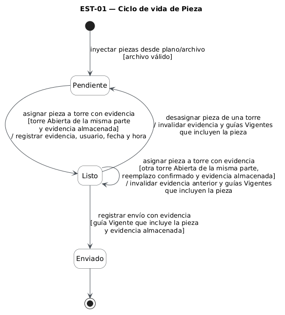
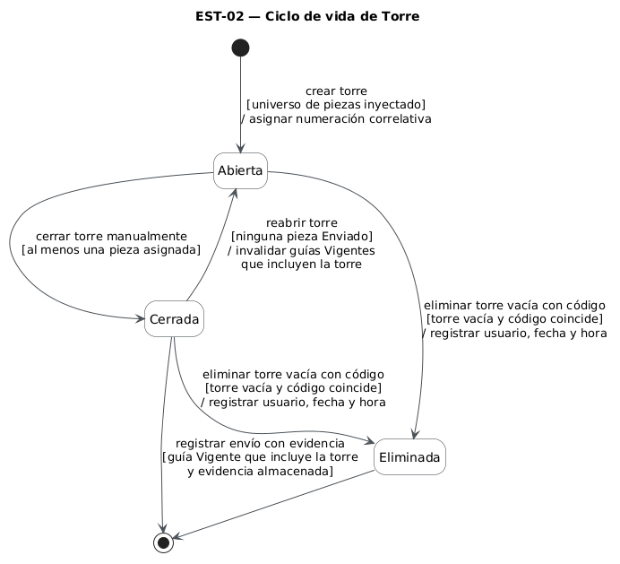
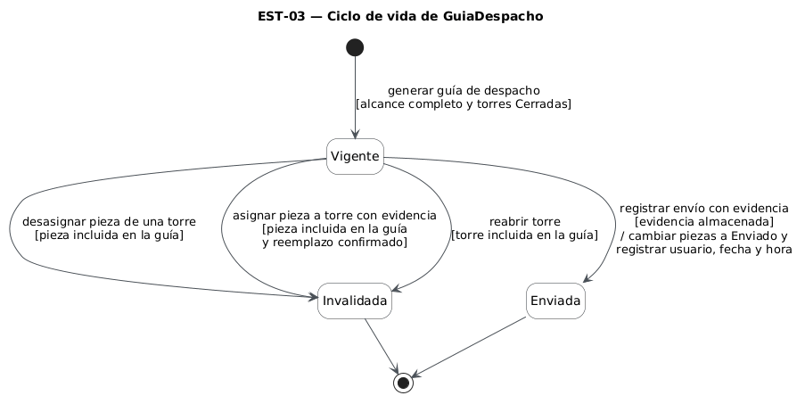

# Diagramas de estado

Este documento presenta los diagramas de estado de **SnapSip** en notación UML 2.0. Modelan el ciclo de vida de las tres clases del [modelo de dominio](./08-modelo-dominio.md) cuyo atributo `estado` controla el despacho: Pieza, Torre y GuiaDespacho.

Convenciones:

- Los estados son situaciones del negocio, con los mismos nombres que los valores del atributo `estado` en el modelo de dominio.
- Cada transición se rotula `evento [guarda] / acción`. Los eventos llevan el nombre del caso de uso que los origina y coinciden con los mensajes de los [diagramas de secuencia](./10-diagramas-secuencia.md) cuando la historia tiene uno.
- Una transición hacia el estado final sin evento es una transición de finalización: el objeto ya no admite más cambios y su ciclo de vida termina.

---

## EST-01 — Ciclo de vida de Pieza

- Clase del dominio: [Pieza](./08-modelo-dominio.md)
- Diagramas de secuencia relacionados: [DSS-01](./10-diagramas-secuencia.md) (asignar pieza a torre) y [DSS-02](./10-diagramas-secuencia.md) (registrar envío)
- Casos de uso e historias de origen: [CU-03](./09-casos-de-uso.md) / [HU-03](./04-historias-usuario.md#hu-03), [CU-05](./09-casos-de-uso.md) / [HU-05](./04-historias-usuario.md#hu-05), [CU-09](./09-casos-de-uso.md) / [HU-09](./04-historias-usuario.md#hu-09) y [CU-11](./09-casos-de-uso.md) / [HU-11](./04-historias-usuario.md#hu-11)
- Requisitos: RP-03, RP-05, RP-10, RP-12, RD-01

Archivo fuente: [`./diagramas/est-01.puml`](./diagramas/est-01.puml)

### Estados

- **Pendiente:** la pieza está registrada en su parte de la casa y no tiene torre asignada (HU-03 CA1).
- **Listo:** la pieza está asignada a una torre de su misma parte y cuenta con evidencia fotográfica vigente (HU-05 CA1).
- **Enviado:** la pieza salió de la bodega en un envío registrado (HU-09 CA1). No admite reasignación ni desasignación (HU-05 CA5, HU-11 CA2).

### Tabla de transiciones

| Estado origen | Evento | Guarda | Acción | Estado destino |
|---------------|--------|--------|--------|----------------|
| Inicial | cargar universo de piezas | archivo válido | — | Pendiente |
| Pendiente | asignar pieza a torre | torre Abierta de la misma parte y evidencia almacenada | registrar evidencia, usuario, fecha y hora | Listo |
| Listo | asignar pieza a torre | otra torre Abierta de la misma parte, reemplazo confirmado y evidencia almacenada | invalidar evidencia anterior y guías Vigentes que incluyen la pieza | Listo |
| Listo | desasignar pieza | — | invalidar evidencia y guías Vigentes que incluyen la pieza | Pendiente |
| Listo | registrar envío | guía Vigente que incluye la pieza y evidencia almacenada | — | Enviado |
| Enviado | — (finalización) | — | — | Final |

---

## EST-02 — Ciclo de vida de Torre

- Clase del dominio: [Torre](./08-modelo-dominio.md)
- Diagramas de secuencia relacionados: [DSS-02](./10-diagramas-secuencia.md) (registrar envío). En [DSS-01](./10-diagramas-secuencia.md), el estado de la torre aparece como condición de la asignación.
- Casos de uso e historias de origen: [CU-04](./09-casos-de-uso.md) / [HU-04](./04-historias-usuario.md#hu-04), [CU-07](./09-casos-de-uso.md) / [HU-07](./04-historias-usuario.md#hu-07), [CU-09](./09-casos-de-uso.md) / [HU-09](./04-historias-usuario.md#hu-09) y [CU-10](./09-casos-de-uso.md) / [HU-10](./04-historias-usuario.md#hu-10)
- Requisitos: RP-04, RP-07, RP-10, RP-11, RD-01

Archivo fuente: [`./diagramas/est-02.puml`](./diagramas/est-02.puml)

### Estados

- **Abierta:** la torre admite piezas de su parte de la casa (HU-04 CA1).
- **Cerrada:** la torre no admite piezas nuevas (HU-07 CA1). Es condición para incluirla en una guía de despacho (RP-09).
- **Eliminada:** la torre vacía fue dada de baja con su código de confirmación. Conserva su registro, con el usuario, la fecha y la hora de la eliminación, y deja de ofrecerse para asignaciones (HU-10 CA1).

El envío no crea un estado nuevo: al registrarse el envío de la guía que la incluye, la torre conserva su registro como Cerrada y su ciclo de vida termina. Desde ese momento no puede reabrirse (HU-07 CA4) ni eliminarse, porque contiene piezas enviadas (HU-10 CA3).

### Tabla de transiciones

| Estado origen | Evento | Guarda | Acción | Estado destino |
|---------------|--------|--------|--------|----------------|
| Inicial | registrar torre | universo de piezas cargado | asignar numeración correlativa | Abierta |
| Abierta | cerrar torre | al menos una pieza asignada | — | Cerrada |
| Cerrada | reabrir torre | ninguna pieza Enviado | invalidar guías Vigentes que incluyen la torre | Abierta |
| Abierta | eliminar torre | torre vacía y código coincide | registrar usuario, fecha y hora | Eliminada |
| Cerrada | eliminar torre | torre vacía y código coincide | registrar usuario, fecha y hora | Eliminada |
| Cerrada | registrar envío | guía Vigente que incluye la torre y evidencia almacenada | — | Final |
| Eliminada | — (finalización) | — | — | Final |

Una torre Cerrada puede quedar vacía si todas sus piezas se desasignan (HU-11 CA1). HU-10 CA1 solo exige que la torre esté vacía y que el código coincida, por lo que `eliminar torre` parte tanto de Abierta como de Cerrada.

---

## EST-03 — Ciclo de vida de GuiaDespacho

- Clase del dominio: [GuiaDespacho](./08-modelo-dominio.md)
- Diagramas de secuencia relacionados: [DSS-02](./10-diagramas-secuencia.md) (generar guía de despacho y registrar envío) y [DSS-01](./10-diagramas-secuencia.md) (asignar pieza a torre, en su variante de reasignación)
- Casos de uso e historias de origen: [CU-05](./09-casos-de-uso.md) / [HU-05](./04-historias-usuario.md#hu-05), [CU-07](./09-casos-de-uso.md) / [HU-07](./04-historias-usuario.md#hu-07), [CU-08](./09-casos-de-uso.md) / [HU-08](./04-historias-usuario.md#hu-08), [CU-09](./09-casos-de-uso.md) / [HU-09](./04-historias-usuario.md#hu-09) y [CU-11](./09-casos-de-uso.md) / [HU-11](./04-historias-usuario.md#hu-11)
- Requisitos: RP-05, RP-07, RP-09, RP-10, RP-12, RD-01

Archivo fuente: [`./diagramas/est-03.puml`](./diagramas/est-03.puml)

### Estados

- **Vigente:** la guía fue generada para un alcance completo con sus torres Cerradas y todavía no tiene envío registrado (HU-08 CA1 y CA3).
- **Invalidada:** después de su generación cambió una pieza o una torre incluida, por lo que la guía ya no representa lo preparado (RD-01). No admite envío ni recupera su vigencia; debe generarse una guía nueva (HU-09 CA3 y CA4).
- **Enviada:** el envío fue registrado con la evidencia fotográfica del camión cargado (HU-09 CA1).

### Tabla de transiciones

| Estado origen | Evento | Guarda | Acción | Estado destino |
|---------------|--------|--------|--------|----------------|
| Inicial | generar guía de despacho | alcance completo y torres Cerradas | — | Vigente |
| Vigente | desasignar pieza | pieza incluida en la guía | — | Invalidada |
| Vigente | asignar pieza a torre | pieza incluida en la guía y reemplazo confirmado | — | Invalidada |
| Vigente | reabrir torre | torre incluida en la guía | — | Invalidada |
| Vigente | registrar envío | evidencia almacenada | cambiar piezas a Enviado y registrar usuario, fecha y hora | Enviada |
| Invalidada | — (finalización) | — | — | Final |
| Enviada | — (finalización) | — | — | Final |

«Alcance completo» significa que el alcance solicitado (una parte de la casa o el proyecto) contiene al menos una pieza y todas están en estado Listo (RP-08). Las tres transiciones de Vigente a Invalidada corresponden a HU-11 CA1 (desasignación), HU-05 CA3 (reasignación) y HU-07 CA3 (reapertura).
