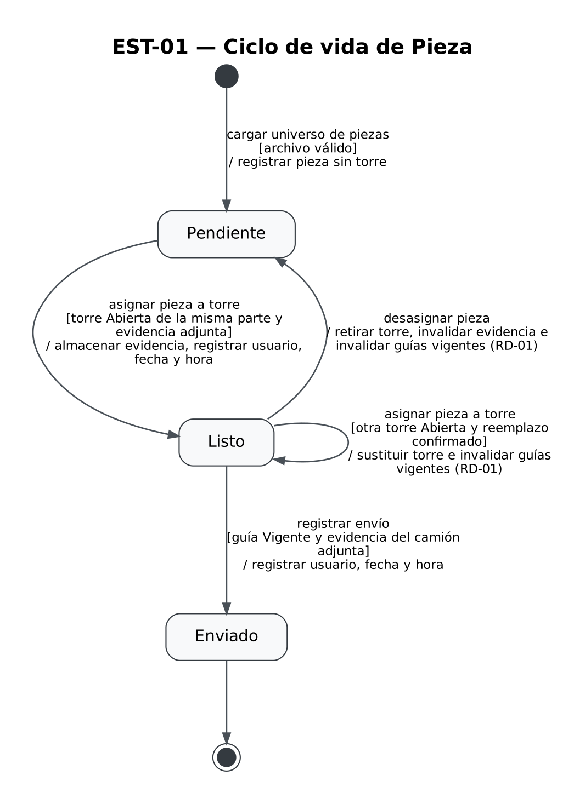
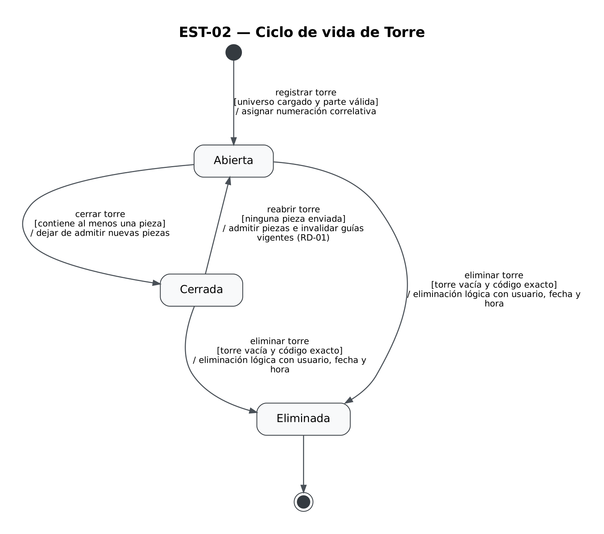
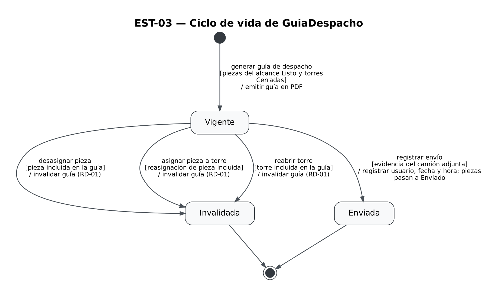

# Diagramas de estado

Este documento presenta los **Diagramas de Estado** del sistema **SnapSip** bajo el estándar **UML 2.0**, modelando el ciclo de vida de las clases del modelo de dominio que presentan transiciones de estado significativas.

Los nombres de los estados corresponden estrictamente a **situaciones o condiciones del negocio** (no a acciones) y los eventos coinciden de manera unívoca con los mensajes modelados en los [diagramas de secuencia de sistema](./10-diagramas-secuencia.md) y las operaciones de los [casos de uso](./09-casos-de-uso.md).

---

## EST-01 — Ciclo de vida de Pieza

- **Clase del dominio:** [Pieza](./08-modelo-dominio.md) (atributo `estado`)
- **Diagramas de secuencia relacionados:** [DSS-01](./10-diagramas-secuencia.md) y [DSS-02](./10-diagramas-secuencia.md)
- **Casos de uso e historias relacionadas:** [CU-03](./09-casos-de-uso.md) ([HU-03](./04-historias-usuario.md#hu-03)), [CU-05](./09-casos-de-uso.md) ([HU-05](./04-historias-usuario.md#hu-05--Asignar-pieza-a-torre-con-evidencia)), [CU-12](./09-casos-de-uso.md) ([HU-12](./04-historias-usuario.md#hu-12)) y [CU-10](./09-casos-de-uso.md) ([HU-10](./04-historias-usuario.md#hu-10--Registrar-envío-con-evidencia))

Archivo fuente: [`./diagramas/est-01.mmd`](./diagramas/est-01.mmd)

### Descripción de los estados
- **`Pendiente`:** La pieza está registrada en el universo del proyecto y asociada a su parte de la casa, pero aún no tiene torre física asignada ni respaldo fotográfico.
- **`Listo`:** La pieza ha sido verificada físicamente, asignada a una torre abierta de su misma parte y cuenta con evidencia fotográfica obligatoria registrada con usuario, fecha y hora.
- **`Enviado`:** La pieza se encuentra cargada físicamente en el camión y su salida de bodega fue respaldada mediante una guía de despacho vigente con envío registrado. Es un estado terminal; una pieza enviada no admite desasignación ni modificaciones.

### Tabla de transiciones — Pieza
| Estado origen | Evento | Guarda | Acción | Estado destino |
|---|---|---|---|---|
| `[*]` | importar archivo de piezas | archivo válido con filas completas | registrar pieza asociada a su parte de la casa en el proyecto | `Pendiente` |
| `Pendiente` | asignar pieza a torre | torre Abierta de la misma parte y evidencia fotográfica adjunta | almacenar evidencia fotográfica, asociar pieza a torre y registrar auditoría (usuario, fecha y hora) | `Listo` |
| `Listo` | asignar pieza a torre | nueva torre Abierta de la misma parte y confirmación de reemplazo | almacenar nueva evidencia fotográfica, actualizar asociación de torre e invalidar guías vigentes no enviadas | `Listo` |
| `Listo` | desasignar pieza | — | desvincular pieza de la torre, invalidar evidencia de asignación actual e invalidar guías vigentes no enviadas (RD-01) | `Pendiente` |
| `Listo` | registrar envío | guía de despacho Vigente y evidencia fotográfica del camión adjunta | amparar salida física de la pieza en el envío y registrar usuario, fecha y hora | `Enviado` |
| `Enviado` | — | — | — | `[*]` |

---

## EST-02 — Ciclo de vida de Torre

- **Clase del dominio:** [Torre](./08-modelo-dominio.md) (atributo `estado`)
- **Diagramas de secuencia relacionados:** [DSS-01](./10-diagramas-secuencia.md) y [DSS-02](./10-diagramas-secuencia.md)
- **Casos de uso e historias relacionadas:** [CU-04](./09-casos-de-uso.md) ([HU-04](./04-historias-usuario.md#hu-04)), [CU-07](./09-casos-de-uso.md) ([HU-07](./04-historias-usuario.md#hu-07)), [CU-11](./09-casos-de-uso.md) ([HU-11](./04-historias-usuario.md#hu-11)) y [CU-10](./09-casos-de-uso.md) ([HU-10](./04-historias-usuario.md#hu-10--Registrar-envío-con-evidencia))

Archivo fuente: [`./diagramas/est-02.mmd`](./diagramas/est-02.mmd)

### Descripción de los estados
- **`Abierta`:** La torre fue creada para una parte específica de la casa y está disponible para recibir asignaciones físicas de piezas de esa parte.
- **`Cerrada`:** El operario cerró manualmente la torre al completar su capacidad física. No admite nuevas piezas. Es condición obligatoria para generar una guía de despacho que incluya esta torre.
- **`Despachada`:** La torre y todas sus piezas fueron cargadas en el camión y despachadas con guía de despacho vigente. Es un estado terminal.

### Tabla de transiciones — Torre
| Estado origen | Evento | Guarda | Acción | Estado destino |
|---|---|---|---|---|
| `[*]` | crear torre | universo de piezas cargado y parte de la casa válida | asignar código correlativo dentro del proyecto y vincular a la parte | `Abierta` |
| `Abierta` | cerrar torre | contiene al menos una pieza asignada | cambiar estado y bloquear recepción de nuevas piezas | `Cerrada` |
| `Abierta` | eliminar torre | torre vacía (cero piezas) y código de confirmación coincide | registrar eliminación lógica en auditoría | `[*]` |
| `Cerrada` | reabrir torre | ninguna de sus piezas ha sido enviada | habilitar recepción de piezas e invalidar permanentemente las guías vigentes que incluyan la torre (RD-01) | `Abierta` |
| `Cerrada` | registrar envío | todas las piezas de la torre amparadas en guía de despacho Vigente con evidencia de camión | consolidar salida física del bulto y registrar auditoría de despacho | `Despachada` |
| `Despachada` | — | — | — | `[*]` |

---

## EST-03 — Ciclo de vida de GuiaDespacho

- **Clase del dominio:** [GuiaDespacho](./08-modelo-dominio.md) (atributo `estado`)
- **Diagramas de secuencia relacionados:** [DSS-02](./10-diagramas-secuencia.md)
- **Casos de uso e historias relacionadas:** [CU-09](./09-casos-de-uso.md) ([HU-09](./04-historias-usuario.md#hu-09)), [CU-10](./09-casos-de-uso.md) ([HU-10](./04-historias-usuario.md#hu-10--Registrar-envío-con-evidencia)), [CU-12](./09-casos-de-uso.md) ([HU-12](./04-historias-usuario.md#hu-12)) y [CU-07](./09-casos-de-uso.md) ([HU-07](./04-historias-usuario.md#hu-07))

Archivo fuente: [`./diagramas/est-03.mmd`](./diagramas/est-03.mmd)

### Descripción de los estados
- **`Vigente`:** La guía oficial fue emitida en PDF tras validar que el 100% de las piezas del alcance solicitado están `Listo` y en torres `Cerradas`. Es apta para autorizar la carga del camión en bodega.
- **`Invalidada`:** La guía perdió su validez oficial debido a que, con posterioridad a su emisión, se desasignó una pieza (HU-12) o se reabrió una torre incluida (HU-07), rompiendo la regla de integridad RD-01. Es un estado terminal: no admite registro de envío ni recupera vigencia; debe emitirse una nueva guía.
- **`Enviada`:** El camión cargado salió de la bodega y el envío fue formalizado con la fotografía de respaldo adjunta. Es el estado final de cumplimiento exitoso.

### Tabla de transiciones — GuiaDespacho
| Estado origen | Evento | Guarda | Acción | Estado destino |
|---|---|---|---|---|
| `[*]` | generar guía de despacho | 100% de piezas del alcance en estado Listo y torres asociadas Cerradas | generar documento oficial en PDF con número correlativo, fecha de emisión y detalle de piezas y torres | `Vigente` |
| `Vigente` | desasignar pieza / reabrir torre | la pieza o torre modificada está incluida en la guía de despacho | marcar guía como anulada, bloquear registro de envío y notificar requerimiento de nueva guía (RD-01) | `Invalidada` |
| `Vigente` | registrar envío | evidencia fotográfica del camión cargado adjunta | registrar salida de camión, almacenar evidencia fotográfica en servicio externo y cambiar piezas a estado Enviado | `Enviada` |
| `Invalidada` | — | — | — | `[*]` |
| `Enviada` | — | — | — | `[*]` |
