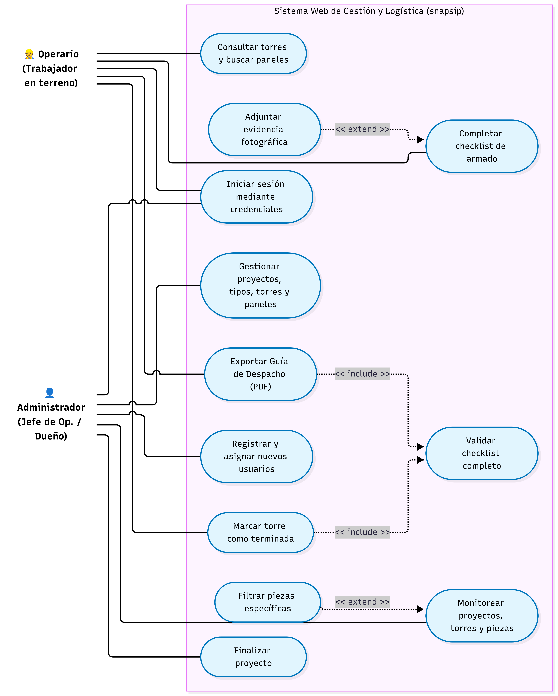
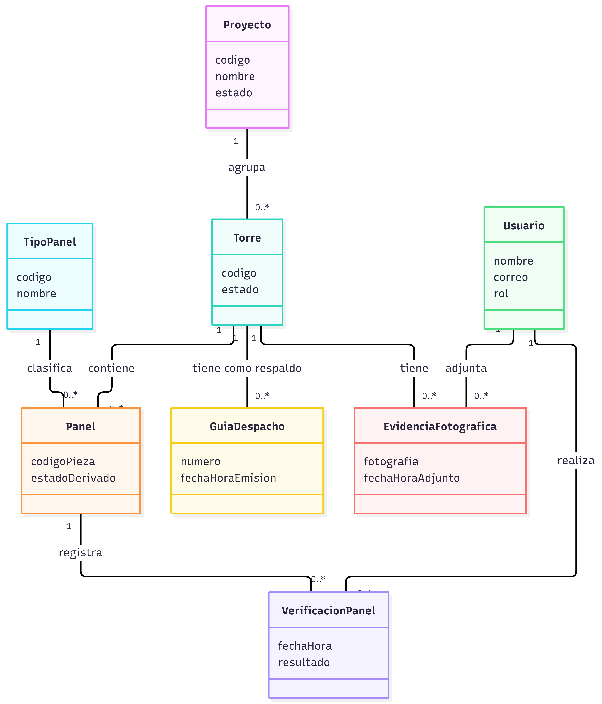

# Diagramas del Proyecto

Este documento recopila los diagramas del sistema del proyecto **Snapsip** (excluyendo los diagramas de procesos AS-IS y TO-BE).

---

## 1. Diagrama de Casos de Uso
* **Enlace a la imagen:** [Ver Diagrama de Casos de Uso](./diagramas/diagramasdecasodeuso.png)

---

## 2. Modelo de Dominio
* **Enlace a la imagen:** [Ver Modelo de Dominio](./diagramas/modelodominio.png)

---

## 3. Diagrama de Secuencia
* **Enlace a la imagen:** [Ver Diagrama de Secuencia](./diagramas/Untitled%20diagram-2026-10-27-020609.png)

