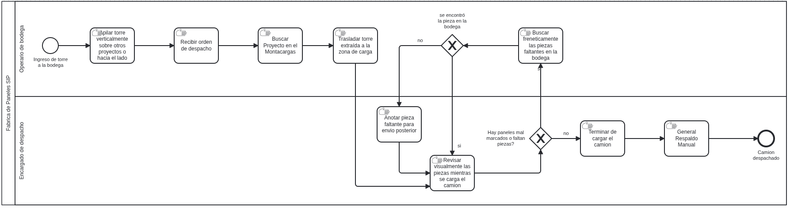
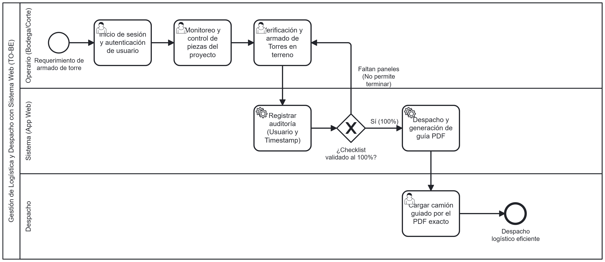
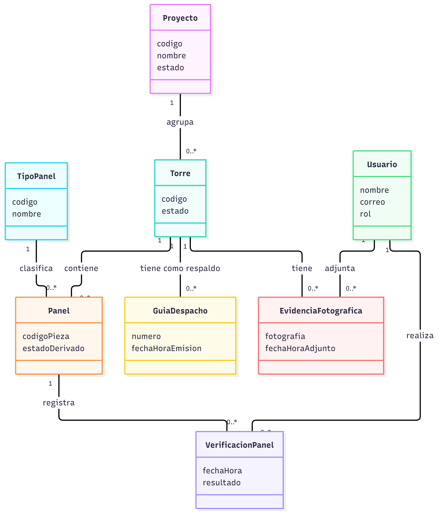

# Diagramas del proyect

Esta carpeta guarda las imágenes de los diagramas del proyecto.

[Volver al README principal](../README.md)

[Abrir imagen original](./proceso-as-is.png)

[Abrir imagen original](./To_be_v2.png)

[Abrir imagen original](./modelodominio.png)

Para agregar un nuevo diagrama, guarda su imagen en esta carpeta y añade aquí su enlace y vista previa.
